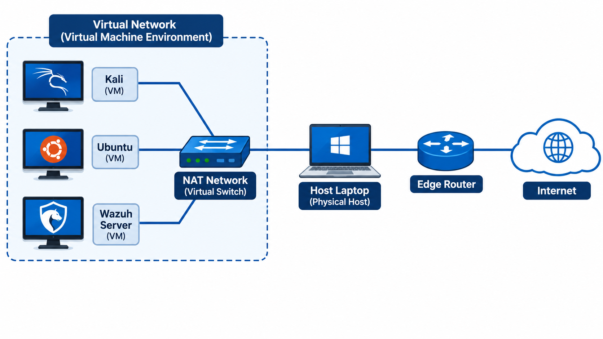

---

---

# Virtual Homelab

Welcome to my virtual homelab environment. This lab consists of three virtual machines connected through a NAT Network, providing an isolated environment for cybersecurity experimentation, network monitoring and digital forensic investigations.

## Network Topology

The following diagram illustrates the network architecture and connectivity of my virtual lab.

  

### Virtual Machines

| Virtual Machine | Purpose |
|---|---|
| Kali Linux | Penetration testing and security assessments |
| Ubuntu | Linux server and testing environment |
| Wazuh Server | Security monitoring, SIEM and threat detection |

### Network Infrastructure

| Component | Description |
|---|---|
| NAT Network | Virtual network connecting all three VMs |
| Host Laptop | Physical machine hosting the virtual environment |
| Edge Router | Provides network connectivity to the internet |
| Internet | External network connectivity |

